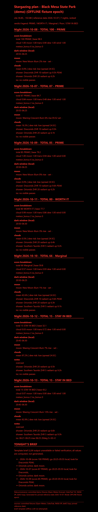
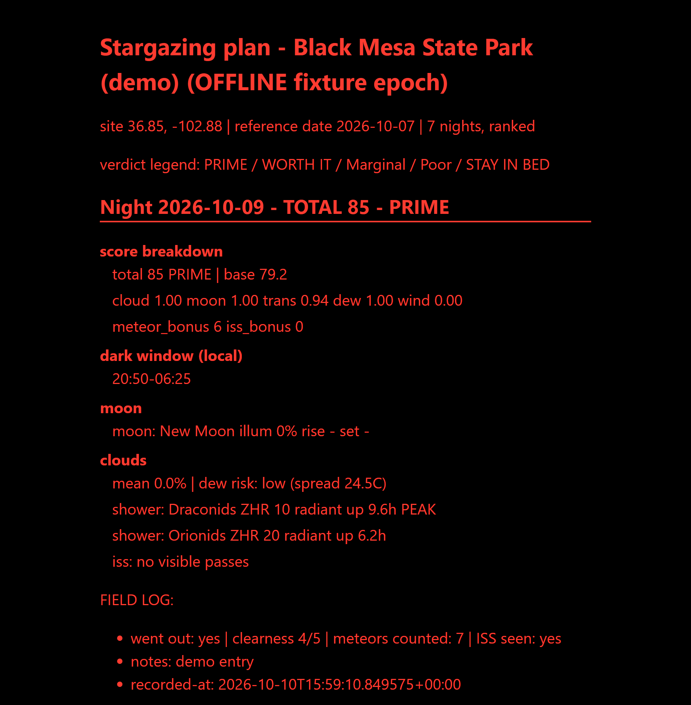

# clearnight

A stargazing planner that ranks the next week of nights for your site. For each
night it computes astronomical dark windows, Moon phase and rise/set, ISS passes,
meteor showers, and the cloud forecast, then scores and ranks the nights with a
clear verdict (GO / MARGINAL / NO-GO). It layers in local sky-sensor readings, a
grounded LLM observing brief that is verified against the computed numbers, and a
field log that records what actually happened so you can compare predictions to
outcomes over time.

## Install

Requires Python 3.12+.

```
git clone <your-fork-url> clearnight
cd clearnight
py -3.12 -m pip install -e .
```

Notes:

- On Windows, the tz database comes from the pinned `tzdata` package (already in
  the dependencies; no extra step).
- The astronomy engine is `skyfield`, pinned to `1.49.0` for reproducibility.

## Quick start (offline demo, ≤ 5 commands)

```
git clone <your-fork-url> clearnight
cd clearnight
py -3.12 -m pip install -e .
py -m clearnight plan --offline
```

Then open `out/plan.html` in a browser. The offline mode runs entirely from
committed fixtures — a bundled reference week (Oct 7–13 2026) for the demo site
(Black Mesa State Park, OK: 36.85 N, −102.88 W) — so the output is identical on
every machine, needs no network, and contains no private data.

## Going online

```
py -m clearnight fetch     # refresh cached external data
py -m clearnight plan      # build a plan for the real upcoming week
```

Data sources:

- **Weather** — Open-Meteo daily/hourly forecast (keyless, no account).
- **ISS / TLE** — CelesTrak.
- **Ephemeris** — NASA JPL `de421.bsp`; the first run downloads ~17 MB into
  `cache/` once, then it is reused.

Fetches are cached in `cache/` with fallbacks: if a source is unreachable, the
plan still renders from the last good cache (or the committed fixtures for the
ephemeris-independent parts).

**LLM brief:** any OpenAI-compatible endpoint works. Set `base_url`, `model`,
and (optionally) `api_key` and extra headers in the `[llm]` section of
`config.local.toml`. Reasoning models spend tokens thinking before the answer —
give them a `max_tokens` budget headroom and a generous `timeout_s` (the example
config ships with values measured against a local 27B reasoning model; see the
comments there). Every brief is verified against the computed plan numbers
before it is shown; unverifiable claims are dropped and reported.

## Sensor setup

clearnight can blend a local sky-quality sensor (temperature, humidity,
pressure, dew point) into the conditions display. Two kinds are supported in the
`[sensor]` section:

**CSV file** (`kind = "csv"`):

```toml
[sensor]
kind = "csv"
path = "my_station.csv"
```

with a file whose header row is exactly:

```
timestamp_utc,temperature_c,humidity_pct,pressure_hpa,dew_point_c
2026-10-06T00:00:00Z,23.9,38,1012.8,8.7
```

**HTTP JSON endpoint** (`kind = "http_json"`) — e.g. a Home Assistant or custom
station API. `field_map` maps Reading fields to dotted paths in the JSON
response:

```toml
[sensor]
kind = "http_json"
url = "http://your-station/api/latest"
field_map = { temperature = "temperature_c", humidity = "humidity_pct", pressure = "pressure_hpa", dew_point = "dew_point_c" }
timeout_s = 10

[sensor.headers]
Authorization = "Bearer <token>"   # config.local.toml ONLY
```

Tokens live in `config.local.toml` only — that file is gitignored from the
first commit and must never be committed. Tip: run the plan once and check the
sensor block in the output/summary to verify your mapping resolves.

## Field log

Record what actually happened, then see predictions vs. outcomes side by side
in the plan's FIELD LOG blocks:

```
py -m clearnight log --date 2026-10-08 --went-out --clearness 4 --meteors 12 --iss-seen --notes "transparent, light dew"
```

Flags: `--date` (required), `--went-out`, `--clearness 0-5`, `--meteors N`,
`--iss-seen`, `--notes TEXT`. Entries append to `out/fieldlog.jsonl` and are
matched to the ranked nights on the next plan run.

## Privacy & data

- Your coordinates, sensor URLs, and API keys go in `config.local.toml`
  (gitignored) — never in code, tests, fixtures, or commit history.
- The demo site (Black Mesa State Park) is public land and the bundled fixtures
  contain only its data.
- No telemetry, ever. The test suite runs fully offline from fixtures.

## Project layout

| Path | What it is |
|---|---|
| `clearnight/` | application package (config, sky, forecast, iss, meteors, score, sensor, brief, verify, fieldlog, render) |
| `clearnight/fixtures/` | committed demo-week fixtures for offline mode |
| `tests/` | offline test suite (`python -m unittest discover -s tests`) |
| `cache/`, `out/` | fetched data and generated plans (gitignored) |
| `config.example.toml` | committed, safe example config |

Curious how it was built? See `ARCHITECTURE.md` for the design and
`JOURNAL.md` for the build log — the codebase was written by open-weight AI
models under an orchestrator/builder delegation protocol, with a human owner
doing determinations and field testing.

## Screenshots

Offline plan (demo week): 

Field-log comparison (predictions vs. outcomes): 

The committed `docs/plan-offline.html` is the full generated sample of the
offline plan for the reference week.
